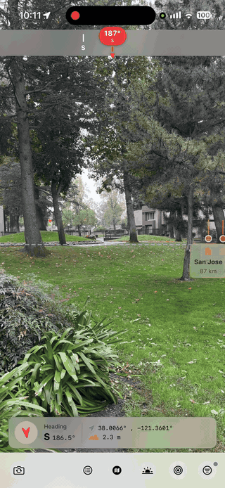
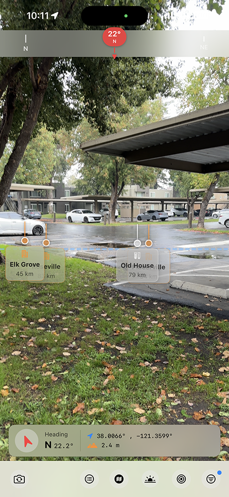
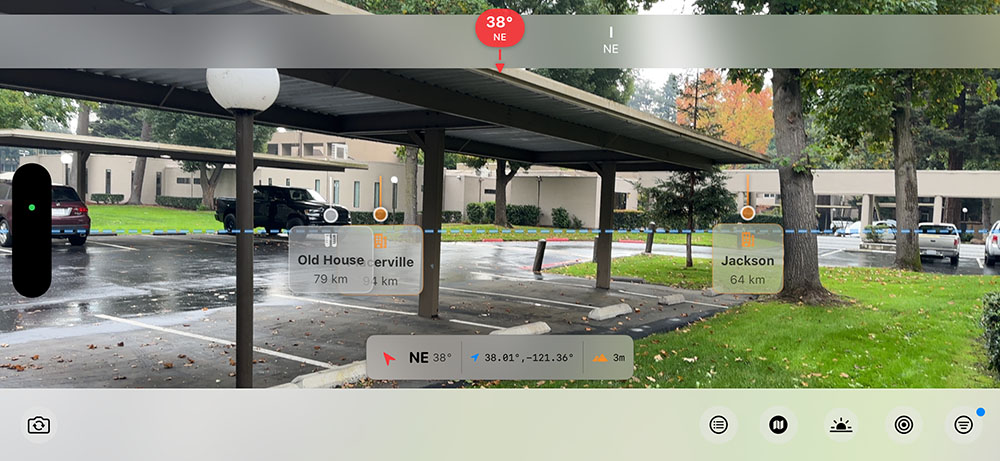
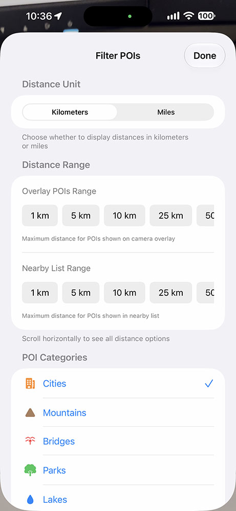
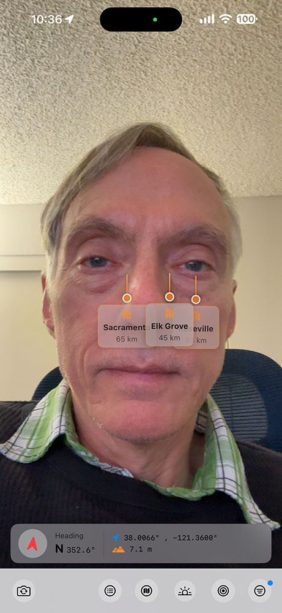
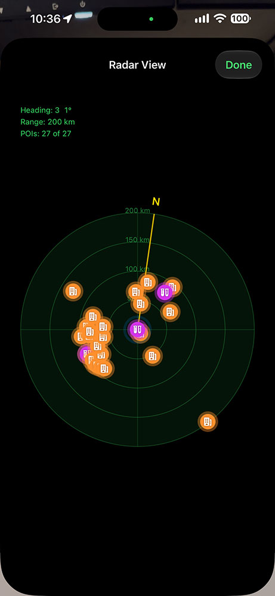

# iOS Heads Up Display
Stuart Rankin\
January 2026\
(Written October 2026)

## Summary
This app shows a live camera view and as the user moves the camera, user-defined locations are shown as markers. Program created with Claude code based on my original code.

## See Also
1. I created a UIKit version of HUDView called [HUDViewUI](https://github.com/sjrankin/HUDViewUI).
2. I also created a watchOS version of HUDView called [POIView2](https://github.com/sjrankin/POIView2).

### Note
This program is not intended or can be used for direction finding or route planning. It is intended only to show where points of interest are relative to your current location.

### Warning
Do not use if you are driving.

## Demo
In the animation below, you will see several points of interest scrolling along the middle of the view. These are pre-set points of interest for testing purposes. The dashed line represents a theoretical horizon to give context to point of interest elevations. Closer points of interest are in front of those further away.

\
The animation above shows the app running and panning across about 100°, looking southwest to northwest.

### Rationale
When I look at the mountains, sometimes I wonder which peaks are where. With this app, I can know. Or know where the destination is that I am traveling. Or find the direction where I used to live.

## Earth Model
The app considers the Earth to be flat in the sense it is an equirectangular structure with local elevation. In the animation, you can see some points of interest are plotted slightly higher or lower than others, due to local elevations.

## User Interface Structure
The user interface has four primary areas:
1. Compass bar at the top.
2. Live view with points of interest along the middle.
3. Detail information about your current location.
4. Toolbar.

The app works fine in either landscape or portrait modes (but was designed to be used in portrait mode). I finished working on the app prior to iOS 26 so some artifacts and misplacements are present.

\
HUDView in portrait orientation. The camera is not obscured by the UI, by design. However, this leaves an awkward live view over the compass.

\
HUDView in landscape orientation. There is a lot more room for points of interest but the top compass should be flush with the top of the screen.

Not all of the controls in the toolbar are active yet.
### Settings
The settings button allows you to add points of interest and set how they appear (in terms of distance).

\
Part of the settings screen.

### Camera
HUDView supports the selfie camera as well.

\
Selfie camera view with points of interest. However, the selfie does not yet have the compass bar implemented.

### Radar View
The radar view plots the points of interest by relative distance and absolute longitude in a radar plot, with the user in the center.

\
Radar plot based on the location where the image was created.

In the image, I am at the center, and the Bay Area is the large mass of points of interests to the lower left. The Sacramento region is spread out to the upper right, and a few outliers are present. The circumreferential lines are distance.

## Limitations
1. I had some difficulties with relative elevations. I want to add a mode for a model of the Earth as a globe, not flat. This would allow for the user to point antipodally to see what was there.
2. Using the app inside does not yield reliable results due to known iPhone hardware limitations. This is especially acute in buildings with metal construction. 

